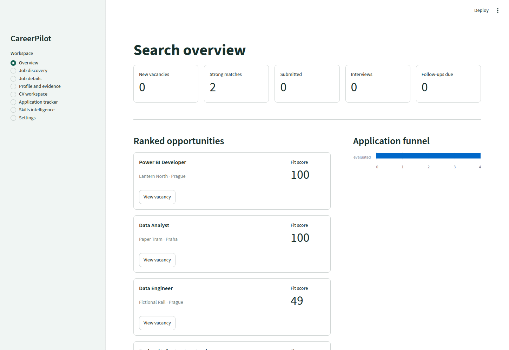
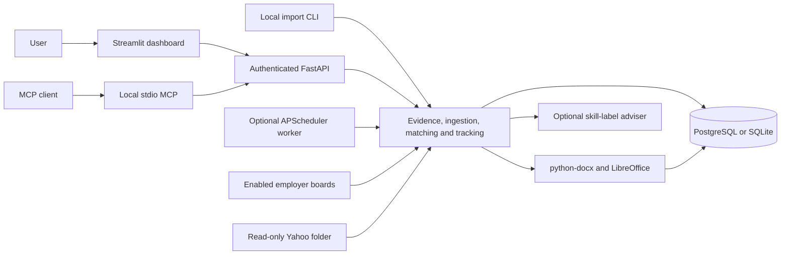

# CareerPilot

CareerPilot is a local, single-candidate workspace for finding technology jobs in the Czech Republic, comparing their requirements with verified experience, and preparing applications. A vacancy can be a promising technical match while still needing clarification about language, salary or work authorisation. The workspace keeps those decisions visible alongside the source text and the candidate’s evidence.



## Try the fictional workspace

From the repository root on Linux, install Python 3.12 with its venv module and LibreOffice Writer with Liberation fonts. Ubuntu package names are `python3.12-venv`, `libreoffice-writer` and `fonts-liberation`. The native path uses SQLite. The Compose path below runs PostgreSQL.

```bash
python3.12 -m venv .venv
source .venv/bin/activate
python -m pip install -r requirements.txt
python -m pip install --no-deps -e .
scripts/start.sh demo
```

Open [the dashboard](http://127.0.0.1:8501). The demo has six fictional baselines and four labelled jobs. In **Job details**, choose Power BI Developer and save the evaluation. In **CV workspace**, generate a draft, inspect its evidence and original baseline, download its PDF and DOCX, then approve the version. **Application tracker** shows the manual confirmation flow. The demo’s application URLs use the reserved `example.invalid` domain. Stop the launcher with Ctrl+C.

To reproduce the fictional acceptance workflow and write sample files in a new private directory, run `python scripts/demo-workflow.py`. The script records a simulated submission in its own disposable database. See the [resulting text](demo/example-cv.txt) and the [rendered A4 page](docs/images/demo-cv.png).

## Use personal data

```bash
source .venv/bin/activate
careerpilot init
careerpilot import-templates private/cv_templates
scripts/start.sh
```

1. Put the six CV variants in `private/cv_templates/`. Include the variant name in each filename, using spaces, underscores or hyphens. The importer prefers DOCX, falls back to text-based PDF and deduplicates repeated uploads by content and variant. Individual uploads support explicit variant selection.
2. Open **Profile and evidence**. Review the original paragraph, employer or project, exact employment dates, employment type, education status, links and any metrics. Mark superseded contradictions `not_approved`. Select `user_confirmed` or `source_supported` and tick the disclosure checkbox for each retained fact. Approve the identity, contact, employment and project headers as well as their associated bullets. This preserves the connections between a claim and its owner.
3. In **Settings**, configure preferences. Leave unconfirmed language proficiency, salary expectations and work authorisation empty. The candidate’s contact fields are private. Include contact information in application materials through a reviewed contact evidence row.
4. In **Job discovery**, paste the title, employer, description and official URL. CSV and JSON imports use the same fields. A URL is stored as a reference. The original description and alternative source records remain available in **Job details**.
5. Examine mandatory skills, missing evidence, score components and eligibility. Save the evaluation or shortlist the job. Inspect suggested duplicates before treating two similar openings as the same vacancy.
6. In **CV workspace**, generate a version. Review the extracted wording alongside the baseline. Regenerate a section or omit a lower-priority evidence ID as needed. Approve the specific final version. Optional recruiter and cover-letter drafts are created on request.
7. In **Application tracker**, open the official page and submit manually. Choose the exact CV and optional letter used, then confirm the submission. Follow-up dates, interview dates, notes and communications remain attached to the vacancy.

Use `CAREERPILOT_PORT` and `CAREERPILOT_DASHBOARD_PORT` to select different native ports. Running a new launcher on an occupied port fails. Keep personal and demo sessions on separate API and dashboard ports when running both at once.

## Architecture



Python 3.12, Pydantic, SQLAlchemy 2, Alembic, HTTPX and the official MCP Python SDK form a modular monolith. Candidate data belongs to a single local workspace. Templates, approved evidence, source records, document bytes and application confirmations have transactional persistence. The document version is its immutable database ID. The schema and package map are in the [architecture notes](docs/architecture/data-model.md).

## PostgreSQL and Docker

Create a private `.env` from [.env.example](.env.example). Set `POSTGRES_PASSWORD` to a locally generated alphanumeric secret. The following initializes a new file only.

```bash
(umask 077; set -C; printf 'POSTGRES_PASSWORD=%s\n' "$(openssl rand -hex 32)" > .env)
docker compose up -d --build
docker compose run --rm init python -m app.cli import-templates /workspace/private/cv_templates
docker compose --profile scheduler up -d worker
docker compose down
```

The API and dashboard publish only to loopback. PostgreSQL stays inside the Compose network and uses a persistent named volume. The native SQLite database and the Compose PostgreSQL database are independent. On Linux with a UID/GID other than 1000, set `LOCAL_UID` and `LOCAL_GID` to the IDs of the owner of the private mount. Native scheduling uses `careerpilot worker`. Enable the desired tasks and intervals in Settings. All tasks start disabled.

For configuration, backups, retention and a deliberate reset, use the [operations guide](docs/operations.md).

## API and MCP

Interactive [OpenAPI documentation](http://127.0.0.1:8000/docs) is available with a running API. `GET /health/live` checks the process and `GET /health/ready` checks the database revision and workspace. All `/v1` operations require a bearer token. Native initialization creates `private/api.token` with owner-only access unless a token was supplied through the environment.

```python
from app.client import WorkspaceAPI

api = WorkspaceAPI()
job = api.call(
    "POST",
    "/jobs",
    json={
        "title": "Data Analyst",
        "company": "Example Transit",
        "location": "Prague",
        "description": "Required: SQL and Excel. Preferred: Python.",
        "url": "https://example.invalid/jobs/analytics",
    },
)
result = api.call("POST", f"/jobs/{job['id']}/match")
print(result["missing_required"], result["eligibility"])
```

The [VS Code configuration](.vscode/mcp.json) launches the stdio bridge after the API is running. Use `private/demo-workspace` as the private path when connecting to the demo API. Tools include `search_jobs({"query":"SQL","location":"Prague"})`, `get_matching_explanation({"job_id":1})`, `generate_tailored_cv({"job_id":1})` and `prepare_application({"job_id":1})`. Review and submission confirmation stay in the authenticated human workflow. See the [MCP guide](docs/integrations/mcp.md).

## Discovery, privacy and evaluation

- Manual import works offline. Yahoo IMAP and employer-enabled Greenhouse, Lever and Ashby reads have deterministic fixture tests. The live Lever demonstration board and one public Greenhouse detail response were also checked. Portal restrictions and integration evidence are recorded in the [capability matrix](docs/integrations/sources.md).
- The default adviser is deterministic. Optional Ollama or OpenAI requests contain controlled skill labels. Spending ceilings, cache behaviour, fact validation, and the separation between fit and eligibility are described in [matching and grounding](docs/architecture/grounding.md).
- Only fictional candidate data belongs in a public checkout. Original templates, generated personal documents, database backups, tokens and mail stay private. See the [threat model](SECURITY.md).
- The expanded synthetic evaluation matched 26 of 30 fit bands and extracted all 81 required and 26 labelled preferred skill occurrences. The earlier four-case run verified one-page exports and preserved hyperlinks. See the [evaluation methodology](docs/architecture/evaluation.md) and [implementation audit](docs/IMPLEMENTATION_AUDIT.md).

## Verification

```bash
source .venv/bin/activate
ruff check .
ruff format --check .
pytest -q
scripts/test-postgres.sh
python scripts/evaluate.py
scripts/smoke-compose.sh
scripts/scan.sh
```

The PostgreSQL helper creates its own loopback-only temporary container. The Compose smoke test builds the image, migrates a separate volume, probes both services and generates a PDF against PostgreSQL. The scan reads the public file set and a local image archive. Run it after the image has been built.

## Release status

The refreshed local image has an open security release gate. Trivy reported one critical and 89 high Debian package findings, with no fixed versions listed for that image. The scan details and limits are in [PROGRESS.md](PROGRESS.md).

## Roadmap

Priorities after the native acceptance workflow are candidate review of imported evidence, evaluation on more Czech and English descriptions, opted-in live Yahoo and employer-board checks, and richer local extraction of alternative requirements, language levels and PDF layouts. Release criteria and remaining integration checks are tracked in [PROGRESS.md](PROGRESS.md).

### First personal application

Open **Profile and evidence** and review the source references in the evidence table. Resolve flagged claims individually. For the remaining claims, select the exact entries under **Approve selected claims**, review their wording and confirm disclosure. Start with identity, contact information, each role or project header and its supporting bullets.

Paste the job description and official link in **Job discovery**. Save the evaluation in **Job details**, then generate, inspect and approve a draft in **CV workspace**. Download PDF and DOCX from the approved version. Open the employer page from **Application tracker** and record the submission after you apply. If you already applied using another CV, choose **Existing CV** and enter its filename or version.
