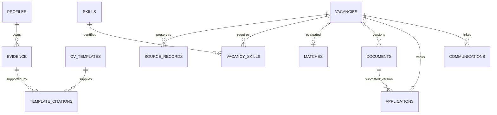

# Architecture and data model

CareerPilot runs as one Python application with multiple local entry points. FastAPI applies bearer authentication and request validation. Streamlit and the stdio MCP server call the same HTTP endpoints. The scheduler and CLI use the same services and SQLAlchemy transactions directly. The source package lives directly under the repository root so editable installation, Alembic and the container share the same import paths.

| Area | Implementation |
| --- | --- |
| Configuration and transactions | `app/config.py`, `app/db.py`, `app/repo.py` |
| Relational data and migrations | `app/models.py`, `migrations/versions/` |
| Input and response contracts | `app/schemas.py`, authenticated routes in `app/api/` |
| Profile review, matching, exports and tracking | `app/services/` |
| IMAP, public boards and AI clients | `app/integrations/` |
| Local tools and worker | `app/mcp_server.py`, `app/scheduler.py`, `app/cli.py` |
| Human workflow | `frontend/dashboard.py` |

Employment history, projects, education and achievements have relational views of typed evidence. Their facts share the verification and disclosure rules of the evidence registry. `GET /v1/profile/history` exposes employment types and source date ranges, project and employer bullets, skills, education, certifications and language claims. Headers retain original wording, including part-time employment. A paragraph citation locates a fact in each supporting template.

Each source record stores its current normalized import payload and original description. Source and identity are unique together. A vacancy has an internal ID, fresh import timestamp, normalized fields, indexed company/location/title and a description fingerprint. Required and preferred skills are also stored in a relational join table. PostgreSQL searches with a simple-language text-search configuration. SQLite uses a case-insensitive substring search.

Applications have a unique vacancy foreign key and foreign keys to exact document versions. Original source bytes, rendering bytes, claims, links, text and hashes share the transaction that creates a document. Application history is retained after closure. Audit events record evidence reviews, generation inputs, approvals, submission confirmation and integration runs. Communications keep a hashed identifier, category, short excerpt and candidate links.

Integration configuration holds mailbox cursors, per-board cache windows and schedule settings. A `scheduled_jobs` view exposes the task configuration. Usage rows store prompt policy, safe input labels, model, usage and estimated cost. The scheduler uses one local process per private directory, coalesced intervals and a filesystem lock. The architecture assumes a single user on a trusted Linux host.
